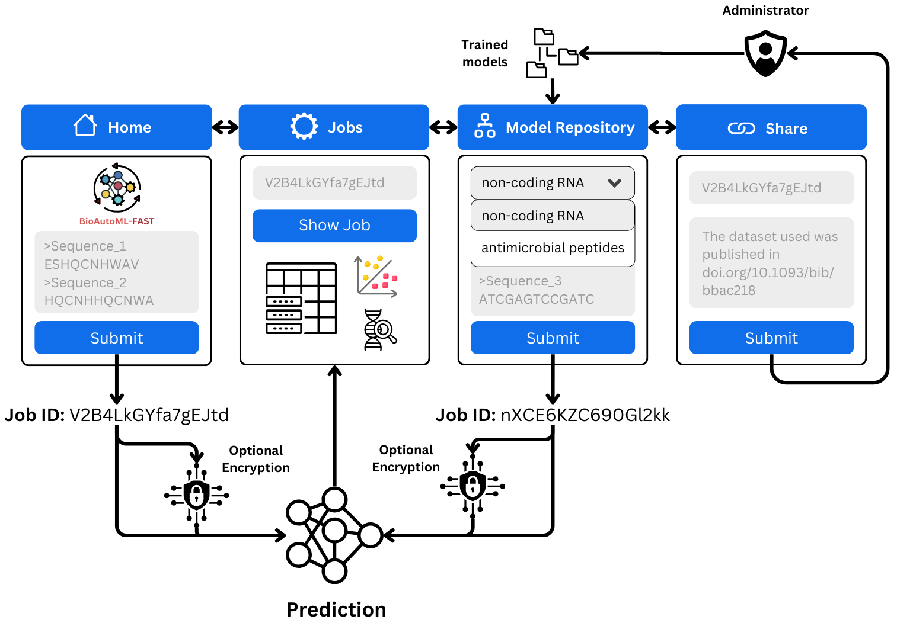
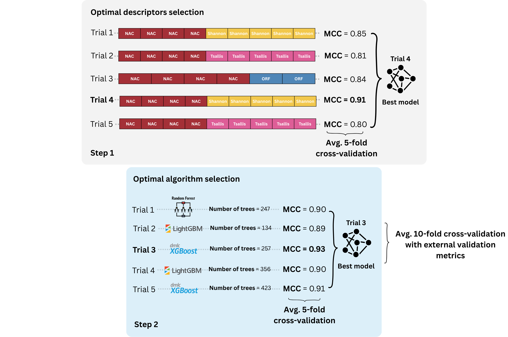

<h1 align="center">
  
</h1>

<h4 align="center">BioAutoML-FAST: Empowering Breakthroughs in Life Sciences with End-to-End Machine Learning</h4>

<p align="center">
  <a href="https://github.com/Bonidia/BioAutoML-FAST/">Home</a> •
  <a href="https://bioautoml.icmc.usp.br/">Web Platform</a> •
  <a href="#installing-dependencies-and-package">Installing</a> •
  <a href="#how-to-use">CLI Usage</a> •
  <a href="#reproducing-the-manuscript-experiments">Experiments</a> •
  <a href="#trained-models">Trained Models</a> •
  <a href="#web-application">Local Web App</a> •
  <a href="#citation">Citation</a>
</p>

Use this repository for CLI training, prediction, and reproducible experiments.
For browser-based use, visit the [hosted platform](https://bioautoml.icmc.usp.br/)
without installing anything locally.

## Awards

⭐ 2025 Google PhD Fellowship in Health Research awarded to support outstanding and innovative research in computer science and related fields, providing total funding of USD 30.000 over two years — [[Link](https://research.google/programs-and-events/phd-fellowship/recipients/?filtertab=2025)]

⭐ ISME Scholar Mobility Fund awarded with funding of € 2.300 for a research period in July 2026 at the Helmholtz Centre for Environmental Research (UFZ) in Leipzig, Germany

⭐ **IRCAI Global Top 100 — Outstanding (2025 edition).** Team recognition for BioAutoML from the International Research Centre on Artificial Intelligence (IRCAI), under the auspices of UNESCO. Recognises accessible machine learning for life sciences supporting UN Sustainable Development Goals 3 (health) and 10 (reduced inequalities). [Official recognition](https://ircai.org/top100/entry/bioautoml-democratizing-machine-learning-in-life-sciences/).

⭐ BioAutoML was selected by Prototypes for Humanity as one of the top 100 projects from nearly 3,000 applications submitted by graduates from over 100 countries. The project received funding for participation and was presented at the international festival in Dubai. More information is available at: [BioAutoML on the event website](https://www.prototypesforhumanity.com/prototypes/bioautoml).

## Abstract

The prediction of biological sequence properties has traditionally relied on alignment-based methods that assume evolutionary homology and depend on curated reference databases. This, in turn, limits scalability and sensitivity for large or heterogeneous datasets, remote homologs, short sequences, and rapidly evolving genomic regions. Although Machine-Learning (ML) approaches offer alignment-free alternatives, their broader adoption is limited by: (i) the lack of standardized, externally validated benchmark models across diverse datasets, and (ii) the technical expertise required for feature engineering, model selection, and evaluation. Automated machine learning (AutoML) alleviates these challenges by systematically optimizing representations and models with minimal user intervention. However, most existing frameworks prioritize task-specific model construction and lack mechanisms for preserving trained models as persistent, comparable benchmarks. We introduce BioAutoML-FAST, an end-to-end web platform for automated ML analysis of nucleotide and amino acid sequences. It supports both classification and regression tasks and automates feature extraction, model training, and evaluation without requiring prior user expertise. Uniquely, it serves as a community benchmarking resource, hosting a continuously expanding repository of 60+ reusable, standardized models for genomic, transcriptomic, and proteomic applications. Extensive validation on independent datasets demonstrates performance comparable to or exceeding that of state-of-the-art methods, including protein language models such as ESM-2. BioAutoML-FAST is available at https://bioautoml.icmc.usp.br/. This website is free and open to all users, and there is no login requirement.

<h1 align="center">
  
</h1>

## Key Features

- **Alignment-free** machine learning for nucleotide and amino acid sequences
- **Automated feature engineering** — Bayesian optimization (Optuna) selects the best descriptor combination from a pool of 20 nucleotide descriptors and 23 protein descriptors
- **Automated model training and hyperparameter optimization** — supports LightGBM, XGBoost, and Random Forest with Optuna-driven tuning
- **Classification and regression** — binary, multiclass, and quantitative prediction tasks
- **Structured data support** — `generation.py` can be used directly with pre-computed feature matrices (CSV), without FASTA input
- **Pre-trained model repository** — 60+ models spanning genomics, transcriptomics, and proteomics, browsable on the web platform
- **Reusable models** — trained models can be saved and re-applied to new sequences for prediction
- **Web platform** — hosted at [bioautoml.icmc.usp.br](https://bioautoml.icmc.usp.br/), no login required; can also be self-hosted

## Authors

* Breno L. S. de Almeida, Robson P. Bonidia, Martin Bole, Anderson P. Avila-Santos, Peter F. Stadler, Ulisses Rocha, André C. P. L. F. de Carvalho

* **Correspondence:** brenoslivio@usp.br, bonidia@utfpr.edu.br or ulisses.rocha@ufz.de

## Publication

Silva de Almeida, B. L., Bonidia, R., Bole, M., Avila-Santos, A., Stadler, P. F., Nunes da Rocha, U., & de Carvalho, A. C. L. F. (2026). BioAutoML-FAST: an automated machine-learning platform for reusable and benchmarked biological sequence models. bioRxiv, 2026-04. [DOI](https://doi.org/10.64898/2026.04.18.719383)

## Installing dependencies and package

Clone the repository and download MathFeature automatically:

```sh
git clone --recurse-submodules https://github.com/Bonidia/BioAutoML-FAST.git
cd BioAutoML-FAST
```

`--recurse-submodules` initializes and downloads MathFeature; no separate
`git submodule` commands are needed for a fresh clone.

### Locked environment with Pixi (Linux)

Install **Pixi 0.81.0**, as required by `pixi.toml`, following the
[official installation instructions](https://pixi.prefix.dev/latest/installation/).

This installs the locked native tools, including MMseqs2, and Python dependencies:

```sh
pixi install --locked
pixi run sync
pixi run uv run --locked --no-dev python engineering.py --help
```

Prefix the CLI commands below with `pixi run uv run --locked --no-dev` to use
this environment. The current Pixi lock targets Linux x86-64.

### Python environment with uv

If native tools are already installed, [install uv](https://docs.astral.sh/uv/getting-started/installation/)
and use it directly:

```sh
uv sync --locked
source .venv/bin/activate
python engineering.py --help
```

On Windows, activate with `.venv\Scripts\activate`. The uv environment does not
install native tools; homology-aware CV requires MMseqs2 on `PATH`.
Use `deactivate` to leave the environment.

## How to use

BioAutoML-FAST uses a two-step pipeline: `engineering.py` handles feature extraction and descriptor selection, then automatically invokes `generation.py` for model training and hyperparameter optimization.

Run commands from the repository root in the installed environment.
Use `python engineering.py --help` or `python generation.py --help` for all options.

<h1 align="center">
  
</h1>

### `engineering.py` 

The `engineering.py` script performs the first step of BioAutoML-FAST. It extracts sequence descriptors from the input FASTA files, performs automated feature engineering/descriptor selection, and then automatically calls `generation.py` for model generation and hyperparameter optimization.

| Option | Description | Default |
|---|---|---|
| `-fasta_train`, `--fasta_train` | One or more training FASTA files. | Required |
| `-fasta_label_train`, `--fasta_label_train` | Labels associated with each training FASTA file. The order must match `-fasta_train`. | Required |
| `-fasta_test`, `--fasta_test` | One or more testing FASTA files. | Optional |
| `-fasta_label_test`, `--fasta_label_test` | Labels associated with each testing FASTA file. The order must match `-fasta_test`. | Optional |
| `-dtype`, `--dtype` | Type of input data. Supported values: `DNA/RNA` or `Protein`. | `DNA/RNA` |
| `-task`, `--task` | Machine learning task. Use `0` for classification and `1` for regression. | `0` |
| `-estimations`, `--estimations` | Number of estimations used during automated feature engineering. | `200` |
| `-patience`, `--patience` | Number of trials without improvement before early stopping. | `80` |
| `-tuning`, `--tuning` | Number of trials used for hyperparameter optimization in `generation.py`. | `150` |
| `-difference`, `--difference` | Minimum improvement required before early stopping. | `0.001` |
| `-n_cpu`, `--n_cpu` | Number of CPU cores to use. Use `-1` to use all available cores. | `-1` |
| `-output`, `--output` | Output directory where results will be saved. | Required |

#### Example: DNA/RNA (nucleotide) classification

Dataset 56 contains *E. coli* K12 RNA sequences from three classes: rRNA, sRNA,
and tRNA. Use the included training and test FASTAs:

```sh
python engineering.py \
  -fasta_train App/datasets/dataset56_bonidia_dnarna_0/train/rRNA.fasta App/datasets/dataset56_bonidia_dnarna_0/train/sRNA.fasta App/datasets/dataset56_bonidia_dnarna_0/train/tRNA.fasta \
  -fasta_label_train rRNA sRNA tRNA \
  -fasta_test App/datasets/dataset56_bonidia_dnarna_0/test/rRNA.fasta App/datasets/dataset56_bonidia_dnarna_0/test/sRNA.fasta App/datasets/dataset56_bonidia_dnarna_0/test/tRNA.fasta \
  -fasta_label_test rRNA sRNA tRNA \
  -dtype DNA/RNA \
  -task 0 \
  -n_cpu 4 \
  -output results/dataset56
```

#### Example: Protein (amino acid) classification

Dataset 2 contains anticancer peptides (positive) and negative examples:

```sh
python engineering.py \
  -fasta_train App/datasets/dataset2_yu_protein_0/train/negative.fasta App/datasets/dataset2_yu_protein_0/train/positive.fasta \
  -fasta_label_train negative positive \
  -fasta_test App/datasets/dataset2_yu_protein_0/test/negative.fasta App/datasets/dataset2_yu_protein_0/test/positive.fasta \
  -fasta_label_test negative positive \
  -dtype Protein \
  -task 0 \
  -n_cpu 4 \
  -output results/dataset2
```

### `generation.py`

The `generation.py` script performs the second step of BioAutoML-FAST. It trains and optimizes machine learning models using the descriptors generated during the feature engineering step. The module supports both classification and regression tasks, including hyperparameter optimization and external test evaluation.

> **Structured data:** `generation.py` can also be used as a standalone script with any pre-computed feature matrix in CSV format — no FASTA input or feature extraction required. This makes it suitable for general tabular ML tasks beyond biological sequences.

| Option | Description | Default |
|---|---|---|
| `-path_model`, `--path_model` | Path to a previously trained model to be reused for prediction or evaluation. | `''` |
| `-task`, `--task` | Machine learning task. Use `0` for classification and `1` for regression. | `0` |
| `-tuning`, `--tuning` | Number of hyperparameter optimization trials. | `150` |
| `-train`, `--train` | Training feature matrix in CSV format. | Required |
| `-train_label`, `--train_label` | Training labels in CSV format. | Required |
| `-train_nameseq`, `--train_nameseq` | CSV file containing sequence names/identifiers for the training set. | Required |
| `-test`, `--test` | Test feature matrix in CSV format. | Optional |
| `-test_label`, `--test_label` | Test labels in CSV format. | Optional |
| `-test_nameseq`, `--test_nameseq` | CSV file containing sequence names/identifiers for the test set. | Optional |
| `-n_cpu`, `--n_cpu` | Number of CPU cores to use. Use `-1` to use all available cores. | `-1` |
| `-output`, `--output` | Output directory where models and results will be saved. | Required |

### Repeatable training

#### CPU use

Set `--n_cpu` to limit descriptor workers and learner threads; `-1` uses the
available CPU allocation. Test-set extraction uses only the selected descriptors.

#### Training controls

Both training scripts accept these options:

| Option | Description | Default |
|---|---|---|
| `--seed` | Seed for learners and shuffled CV folds. | `63` |
| `--search_seed` | Optuna sampler seed. | Same as `--seed` |
| `--search_jobs` | Concurrent Optuna trials; keep at `1` for repeatable trial ordering. | `1` |
| `--pruning` / `--no-pruning` | Enable or disable fold-score pruning in descriptor selection and hyperparameter tuning. | On |
| `--homology_aware` | Automatic MMseqs2 sequence grouping for CV and train–test similarity auditing. Start from FASTA inputs with `engineering.py`; `generation.py` reuses its assignments. | Off |
| `--homology_identity` | Minimum identity in percent (1–100); requires `--homology_aware`. | 90 |
| `--homology_coverage` | Minimum alignment coverage of **each** sequence in percent (1–100); requires `--homology_aware`. | 80 |

The web training form provides the same **Trial pruning** checkbox, checked by
default. Turning it off can increase training time. Search patience, trial caps,
time limits, and rejection of invalid configurations remain unchanged. With
tuning disabled, pruning still applies to descriptor selection; it does not
affect prediction with a saved model. The choice is recorded in run settings and
optimization reports.

#### Regression reporting

Regression reports include MAE, MSE, RMSE, predictive R², and Pearson r.
Both search stages optimize RMSE. Pearson measures association, not absolute
accuracy; correlation squared is not predictive R². Undefined correlations are
reported as missing rather than replaced with a score.

Classification probabilities are model estimates, not guaranteed confidence levels.

#### Optional homology-aware cross-validation and overlap audit

Add these options to an `engineering.py` training command:

```sh
--homology_aware --homology_identity 90 --homology_coverage 80
```

MMseqs2 groups training sequences before CV. The defaults are **90% identity and
80% coverage of each sequence**, for both proteins and nucleotides. Supply
percentages from 1 to 100 (`90`, not `0.9`); threshold options require
`--homology_aware`. Choose thresholds before inspecting test performance.

Both search stages and the ten-fold report respect the training groups.
Classification uses stratified grouped folds. If valid grouped folds cannot be
formed, training stops instead of silently reverting to ordinary CV.
`generation.py` reuses assignments prepared by `engineering.py`; this option
requires sequence inputs, not an arbitrary feature matrix.

With test FASTAs, an exact train–test overlap audit runs even when homology-aware
CV is off. Enabling it adds a similarity audit. Reports and matches are saved in
`reports/homology/`. Auditing does not remove sequences or change the test set.

These thresholds detect close-sequence redundancy, not all homology. Grouped CV
does not eliminate model-selection optimism or overlap in the preserved test set.
Ten-fold results remain **post-selection optimization CV**, not nested evaluation.

#### Repeatability

Keep inputs, row order, dependencies, CPU allocation, seeds and budgets fixed.
Use `--search_jobs 1` for repeatable trial ordering. Different search seeds measure
search variability, not same-seed repeatability; identical results across hardware
or package versions are not guaranteed. Preserve the MathFeature revision and
Docker image used for a run: rebuilding can retrieve newer upstream code.

### Reproducing the manuscript experiments

Run from the repository root, using the locked environment and datasets in
`App/datasets/`. The commands below use 32 CPUs, model/fold seed `63`, and search
seeds `6301`–`6305` (the first three for ablation, learner and pruning comparisons).
The primary benchmark uses tuning and pruning **on**, with ordinary CV.

Prepare the environment, including MMseqs2 for the homology experiment:

```sh
pixi install --locked
pixi run sync
```

Run the tasks individually, in this order. Each task runs only its own experiment;
it does not launch prerequisites.

```sh
pixi run ablation               # 15 datasets × 6 conditions × 3 seeds
pixi run benchmark-first        # First seed across 64 datasets
pixi run learner-aware          # Alternative Stage 1 learners
pixi run budget-sweep           # Stage-specific trial budgets
pixi run homology               # Ordinary and homology-aware CV
pixi run sequence-overlap       # Exact train–test overlap audit
pixi run pruning                # Pruning on/off, 3 datasets × 3 seeds
pixi run benchmark              # Complete/resume five benchmark seeds
```

Optional first-seed pruning-off benchmark:

```sh
pixi run benchmark-pruning-off
```

- **Options:** append `--help` or `--dry_run`, e.g. `pixi run homology --dry_run`.
- **Resume:** benchmark tasks resume automatically. Other tasks accept `--resume`.
  Stop previous runners and workers before restarting. Compatible completed runs
  and descriptors are reused; interrupted benchmark attempts are archived.
- **Outputs:** all scripts live directly in `manuscript/experiments/`; outputs
  remain in `results/<experiment>/` below it. Each experiment saves per-run
  `results.csv` rows, with dataset, seed/condition where applicable, metrics and
  timings, plus its underlying artifacts and provenance. The budget sweep saves
  per-seed checkpoint rows; the overlap audit saves per-dataset counts.
  Cross-seed summaries, paired differences and comparison plots are left to your
  analysis. Existing historical outputs are preserved.
  Both benchmark tasks share `results/benchmarks/`, with one `runs/run_N/`
  directory per completed dataset/seed and a reusable `shared/` descriptor cache.
  `App/datasets` is a single symlink to `manuscript/experiments/results/benchmarks/`.
  Each dataset contains real `train/`, `test/` (when available), `shared/` and
  `runs/` directories. Reused results and caches are copied into this layout.
  Git includes the sequences and bibliography, but excludes generated results.
  Missing seeds are not replaced with older models.
  Benchmark-wide tables (`results.csv`, `results_index.csv`), protocols, inventories,
  worker configurations and logs are stored in the ignored `.benchmark/` directory.
  Keep this directory to resume safely; only dataset folders and `references.bib`
  appear at the visible repository level.
- **Settings:** use `--runs`, `--output` and `--reuse_from` with benchmark tasks
  as needed. Changed inputs, budgets or dependencies cannot be mixed into an
  existing benchmark. Imported artifacts retain their original provenance.
- **Interpretation:** ten-fold scores are post-selection optimization CV, not
  unbiased evaluation. Report test MCC and regression R² separately. Cached or
  additive timings are not standalone end-to-end runtime measurements.

Dataset choices and full protocols are in the
[revision plan](manuscript/revision/SIMPLE_REVISION_PLAN.md).

### Output files

Use a fresh `--output` directory for each CLI execution. The main files are:

| Path | Contents |
|---|---|
| `model/trained_model.sav` | Saved model |
| `results/metrics/` | Optimization-CV and test metrics |
| `results/predictions/` | Predictions with original sequence names |
| `results/descriptors/` | Selected descriptors, feature matrices and importance |
| `reports/optimization/` | Trial histories, settings and stopping reasons |
| `reports/homology/` | Sequence grouping and overlap audits |
| `reports/sequence_names/` | Original headers and unique internal-ID mappings |
| `reports/performance_summary.csv` | Extraction, optimization and total time; peak memory |
| `run.json`, `timings.csv` | Run status, inputs, settings, versions and phase timings |
| `work/features/` | Intermediate extracted features |

CLI summaries show minutes; CSV timings use seconds and memory uses bytes.
Peak memory is sampled process-tree RSS, so shared pages may be counted more
than once. Optimization time excludes final fitting and reporting CV. Failed or
interrupted runs are not completed results.

Duplicate FASTA names are allowed: unique internal IDs preserve row alignment,
while prediction exports retain original names. Regression targets encoded after
`|` in FASTA headers are preserved.

## Trained Models

Browse the model repository at [bioautoml.icmc.usp.br](https://bioautoml.icmc.usp.br/).
Models are also available for offline use on
[Zenodo](https://doi.org/10.5281/zenodo.20349210).

CLI training saves an unsigned model in `model/trained_model.sav`. To use your own
model with `generation.py`, supply `--path_model` and `--trust_unsigned_model`,
along with the test feature inputs. Saved-model prediction does not rerun tuning.

### Predict with a saved model

After running the dataset 2 example above, reuse its model and extracted
test features without retraining:

```sh
python generation.py \
  --path_model results/dataset2/model/trained_model.sav --trust_unsigned_model \
  --task 0 \
  --test results/dataset2/results/descriptors/best_test.csv \
  --test_nameseq results/dataset2/work/features/fnameseqtest.csv \
  --test_label results/dataset2/work/features/flabeltest.csv \
  --n_cpu 4 --output predictions/dataset2
```

Predictions are saved to `predictions/dataset2/results/predictions/test_predictions.csv`.
The saved-model command accepts feature CSVs, not raw FASTA files; their columns
must match the trained model.

For Python integrations:

```python
from bioautoml.model_artifacts import load_model

model = load_model("results/dataset2/model/trained_model.sav", trust_unsigned=True)
```

**Load unsigned models only if you trust their source: deserialization can execute
code.** Use the provided loader rather than `joblib.load()`. Current-format bundles
and compatible dependency versions are required. The web platform accepts only
models signed by an approved deployment; CLI-created models cannot be uploaded
as trusted web models.

## Web Application

Use the hosted application at **[bioautoml.icmc.usp.br](https://bioautoml.icmc.usp.br/)**
for browser-based training, prediction and model exploration. No local installation
or login is required.

### Optional local Docker deployment

With Docker available and `App/datasets/` populated, start a local instance:

```sh
./run-docker.sh
```

Open `http://localhost:8501`. The script rebuilds the image and replaces its
container; running jobs are interrupted. Jobs and database files remain in local
bind-mounted directories. See `./run-docker.sh --help` for options.

To stop and remove both application containers and the image without rebuilding:

```sh
./run-docker.sh --delete
```

Running container jobs are interrupted. Local jobs, database files, datasets,
and signing keys are preserved. If you used custom `CONTAINER_NAME` or
`IMAGE_NAME` values, supply the same values when deleting the deployment.

When run in a terminal, the launcher prompts for the Blablador and Mailgun API
keys with hidden input. Press Enter or enter only whitespace to skip a service.
Your answers replace any inherited API-key values, so a blank answer always
means no key. Entered values are not written to a configuration file or shell
history.

For automated launches without a terminal on standard input, no prompts are
shown; export `BLABLADOR_API_KEY` and `MAILGUN_API_KEY` beforehand if needed.

The launcher creates signing keys automatically using the Docker image; host
Python is not required. It reuses existing keys and starts the signing/training
worker. On a fresh machine, keys are stored outside the repository in
`${XDG_CONFIG_HOME:-$HOME/.config}/bioautoml-fast/model-keys`.
If its training container already exists, the launcher reuses that container's
key directory unless `MODEL_KEYS_DIR` is explicitly set.

To use a different directory or restore keys from another machine:

```sh
MODEL_KEYS_DIR=/absolute/private/location/bioautoml-keys ./run-docker.sh
```

Back up the key directory securely. Existing keys are never overwritten; incomplete
key sets stop startup. New keys do not automatically trust models from another
deployment. Keep private keys out of Git and Docker images. CLI training does not
require signing keys. `App/datasets/references.bib` is included in the repository;
trained model files must be supplied separately for the model repository.
The launcher resolves `App/datasets` and mounts the whole directory read-only
at `/app/App/datasets`. Set `DATASETS_DIR` to use a different repository directory.
Unsigned CLI benchmark artifacts still require trusted signing before web
loading; linking them does not bypass model verification.

## Continuous integration

GitHub Actions checks pull requests and pushes to the default branch by running
`run-docker.sh` with isolated containers, temporary data, and disposable signing
keys. It checks Streamlit, Redis, both workers, CLI startup, and Home-page rendering
in Chromium. No benchmarks or production credentials are used.

## Citation

If you use this code in a scientific publication, we would appreciate citations to the following paper:

Silva de Almeida, B. L., Bonidia, R., Bole, M., Avila-Santos, A., Stadler, P. F., Nunes da Rocha, U., & de Carvalho, A. C. L. F. (2026). BioAutoML-FAST: an automated machine-learning platform for reusable and benchmarked biological sequence models. bioRxiv, 2026-04. [DOI](https://doi.org/10.64898/2026.04.18.719383)

```bibtex
@article{silva2026bioautoml,
  title={BioAutoML-FAST: an automated machine-learning platform for reusable and benchmarked biological sequence models},
  author={Silva de Almeida, Breno Livio and Bonidia, Robson and Bole, Martin and Avila-Santos, Anderson and Stadler, Peter F and Nunes da Rocha, Ulisses and de Carvalho, Andre CP L F},
  journal={bioRxiv},
  pages={2026--04},
  year={2026},
  publisher={Cold Spring Harbor Laboratory}
}
```
